# Video Edit Fonts Styles

My favorite fonts and pairings for video editing.

## Getting started and releases

Download [ready-fonts.zip](ready-fonts.zip) for all eight font families, their
licenses, the font catalogs, installation instructions and checksums. Unzip it,
then open the fonts you want in Font Book on macOS or install them through your
editor. Start with **Poppins ExtraBold + Playfair Display Italic**.

The font bundle is self-contained. Individual video projects may depend on local
source footage, licensed music, Final Cut Pro and project-specific tools.

Maintainers can validate and rebuild the bundle with **Python 3.10+**, with no
third-party Python packages or network access:

```sh
python3 scripts/release_fonts.py check
python3 -m unittest discover -s tests -v
python3 scripts/release_fonts.py build
```

The build writes `dist/ready-fonts.zip`. To refresh the download checked into this
repository, run `python3 scripts/release_fonts.py build --output ready-fonts.zip`.
The builder checks file sizes, SHA-256 hashes, font headers, family licenses and
catalog references before packaging an explicit list of files. It preserves an
existing bundle if validation fails. ZIP timestamps and permissions are fixed
for reproducible builds within the same Python/zlib toolchain.

Run these checks locally before each release. GitHub Actions installation is
still pending a credential with workflow permission. See
[the release guide](docs/releases.md) for scope, verification and the remaining
video-delivery checks.

## Style gallery

Every named style, with a frame from its reference build. Click a name for its spec. All of them follow the shared checklist in [What makes it premium](#what-makes-it-premium).

| [Warm & witty](#main-style-warm--witty) (default) | [Editorial](#alternative-style-editorial) | [Dark cinematic](#alternative-style-dark-cinematic) | [Proof Stack](#alternative-style-proof-stack) |
| --- | --- | --- | --- |
| 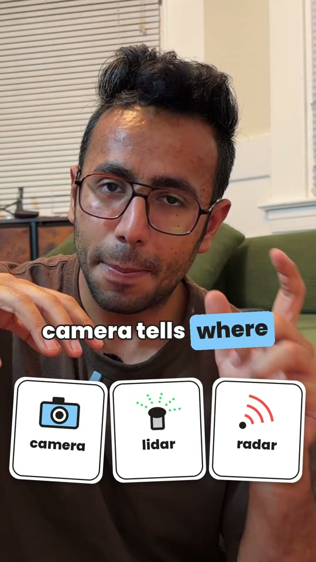 | 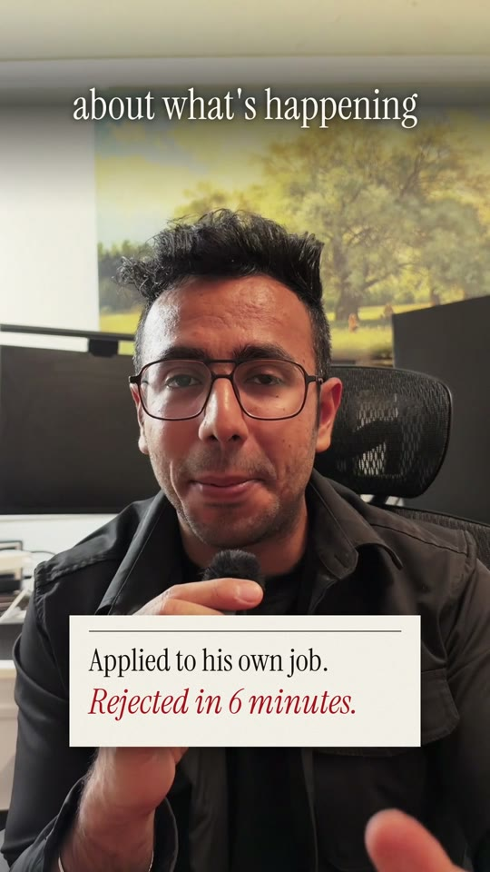 | 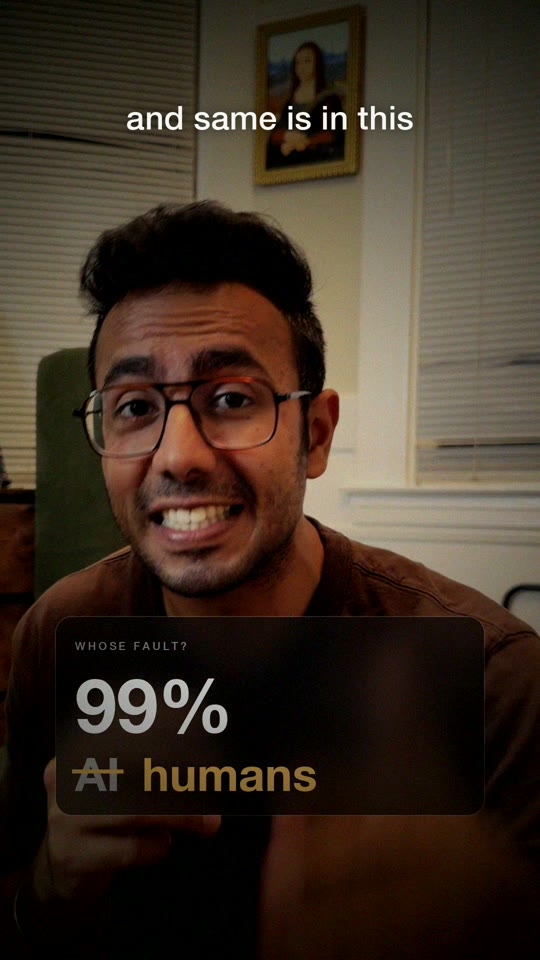 | 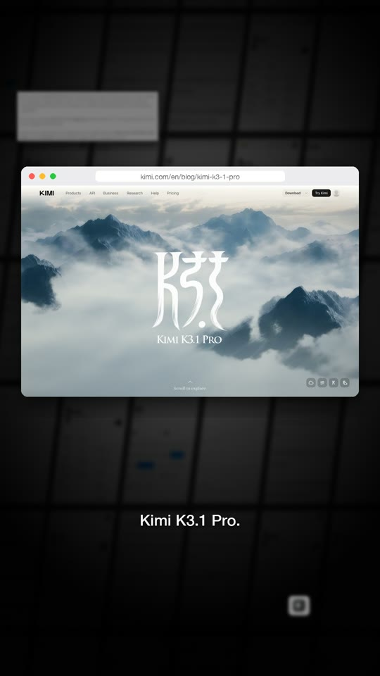 |
| **[Split Stage](#alternative-style-split-stage-nick-saraev-style-my-favourite)** (my favourite) | **[Kallaway crop](#kallaway-crop-pop-out-head)** (Split Stage framing) | **[Dark Stage](#alternative-style-dark-stage)** | **[Minimal Proof](#alternative-style-minimal-proof)** |
| 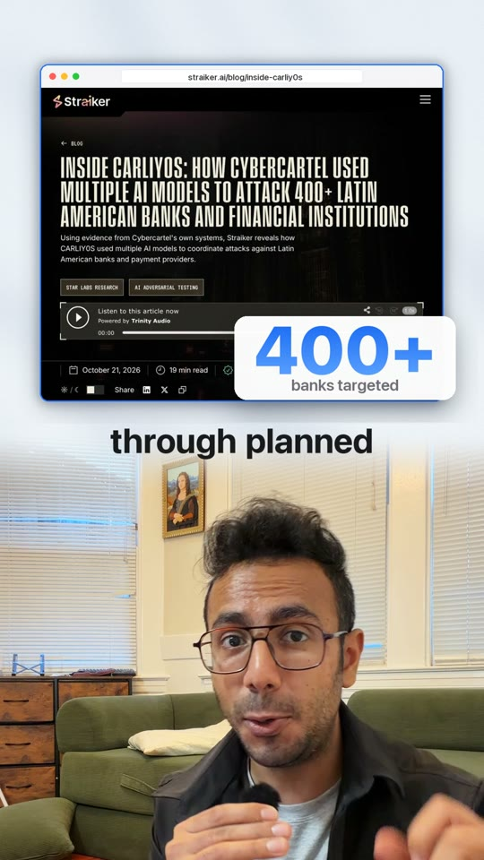 | 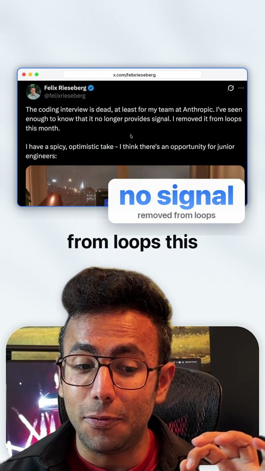 | 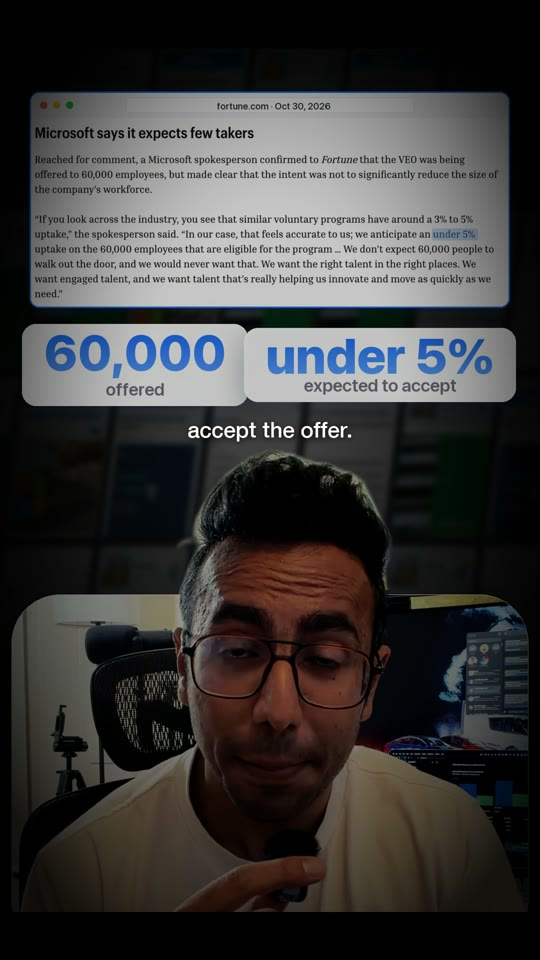 | 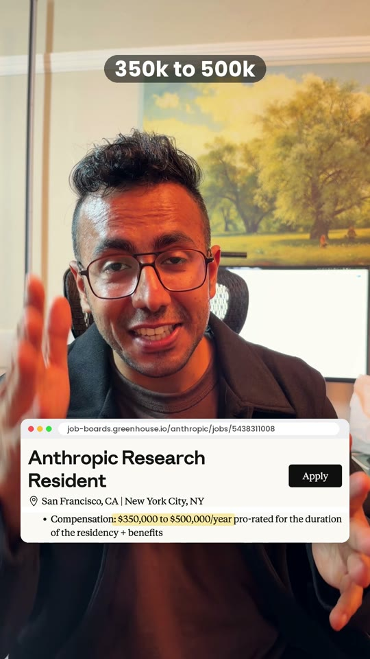 |
| **[RPN](#alternative-style-rpn)** |  |  |  |
| 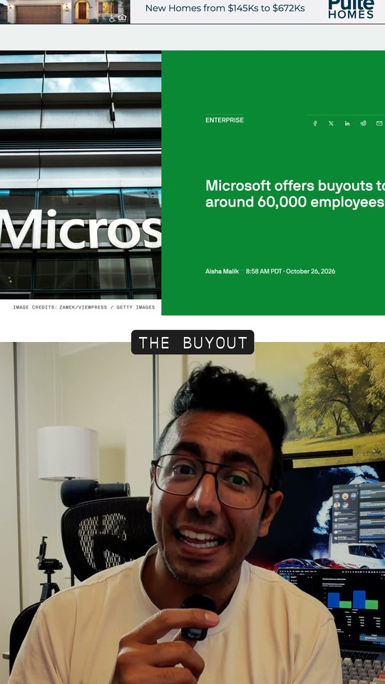 |  |  |  |

### Long-form styles (16:9)

Every long-form look I've used, with a frame from its build. All long form follows the same rules: **no captions**, loose cuts close to the raw take (keep my lines and add a small context note instead of cutting a claim), and screen recording + corner cam where there's a screen. Click a name for its spec.

| [Screen Share](#long-form-screen-share-default) (default) | [Light Stage](#long-form-light-stage) | [Paper Podcast](#long-form-paper-podcast) | [Night Desk-Typecraft](#long-form-night-desk-typecraft) (new) |
| --- | --- | --- | --- |
| 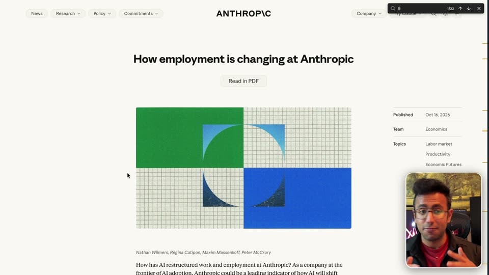 | 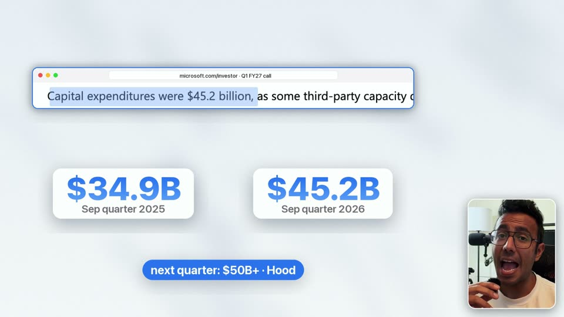 | 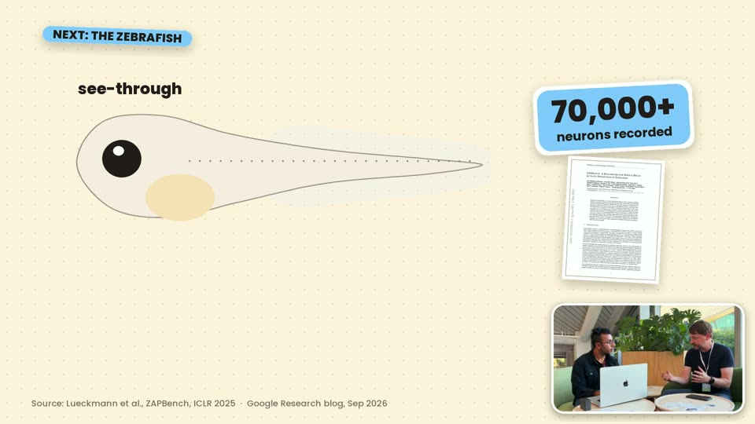 | 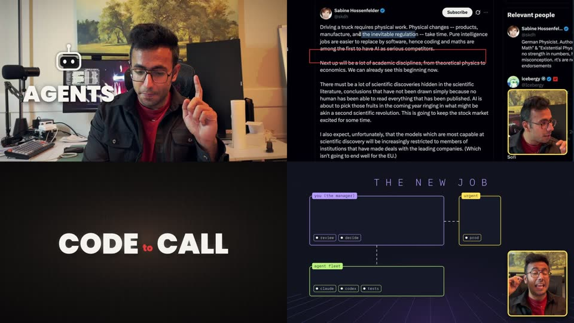 |
| **[Paper Explainer](#long-form-paper-explainer)** | **[Riley](#long-form-riley)** (new) |  |  |
| 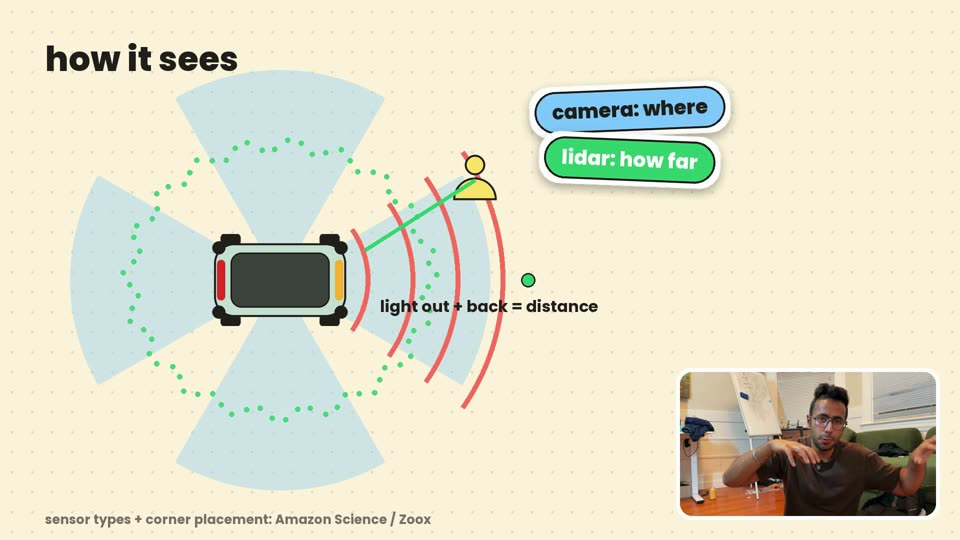 | 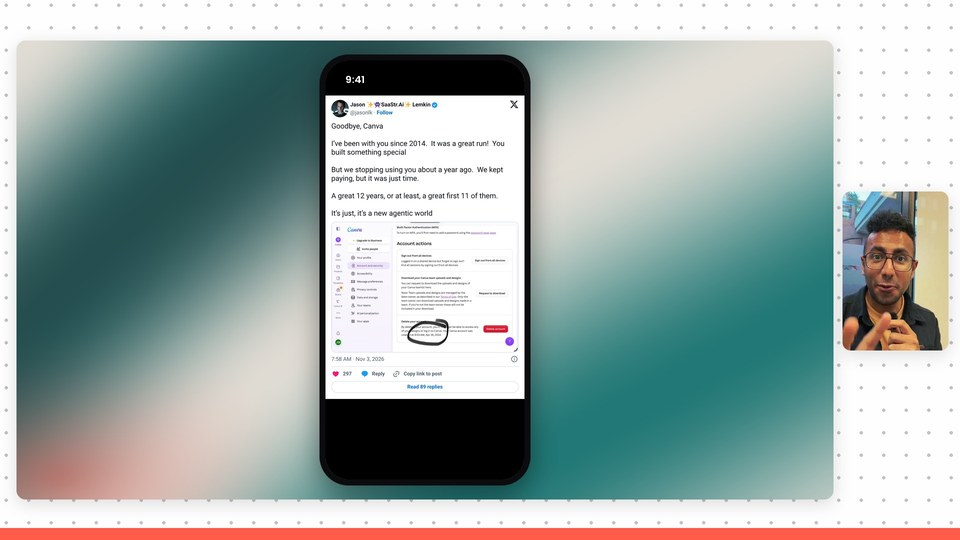 |  |  |

#### Worth trying next (not built yet)

These are four long-form looks that fit the topics I cover. Each one says what makes it work and which pieces of this repo it would reuse. None has been used on a real video yet, so each example is a mock-up made from footage I already have (IMG_1255, the IMG_1095 sources, the we-need-to-talk screen recording and the Zoox ride), with `styles/samples/long-ideas/examples.py`. Once a style is used for real, it moves into the table above with a frame from that build.

| Style | Example | What it is | Use it when | Build it with |
| --- | --- | --- | --- | --- |
| **Paper Trail** | 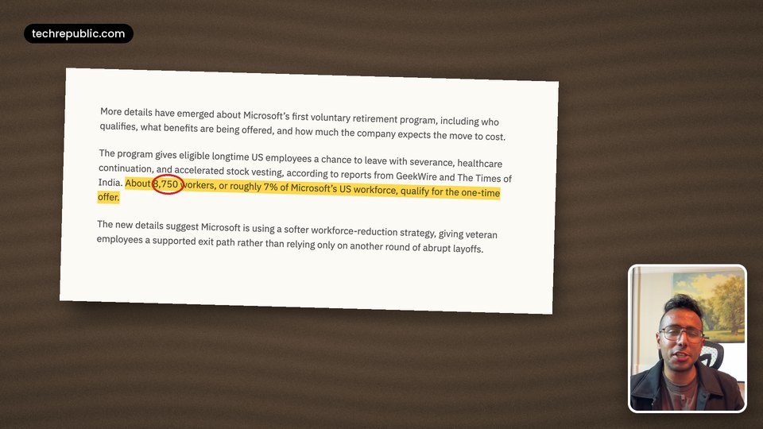 | Real documents shot or rebuilt as paper on a desk: a policy page, a court filing, a map. Marker circles and underlines draw on as I read the line, and the camera pushes into each one. | Immigration, H-1B, layoffs, law and policy, where the source document *is* the story. | Playwright page captures laid on a paper texture, Split Stage's `Mark` for the marker and a slow push. Real sources only, with the URL in a corner tag. |
| **Data Story** | 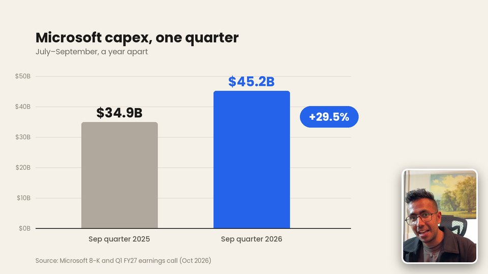 | One chart per beat, full frame with the corner cam. Lines draw left to right, bars grow and the key number counts up on the word I say it. Honest axes, the source under every chart. | Salaries, job numbers, CapEx, model benchmarks: any video where a number carries the argument. | The `dataviz` skill for chart rules, rendered as frames with the corner cam baked in (like the Light Stage scenes). One idea per chart, ≤6 words of labels. |
| **Build Log** | 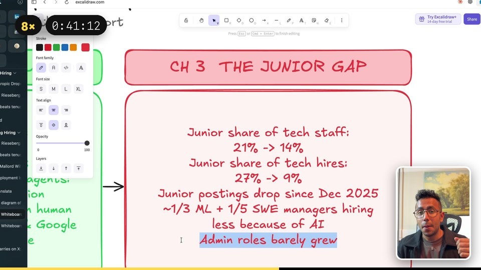 | I build something live. The screen speed-ramps through the boring parts (4–8×, with a small timer chip) and drops to 1× for the moments that matter: the first run, the bug, the fix. | "I built X with Claude in a day", agent and coding videos. | Screen Share's sync and corner cam, plus speed ramps on lane 2 (frame-exact FCPXML `timeMap`). The cut still keeps every line I say over the 1× parts. |
| **Walk & Talk** | 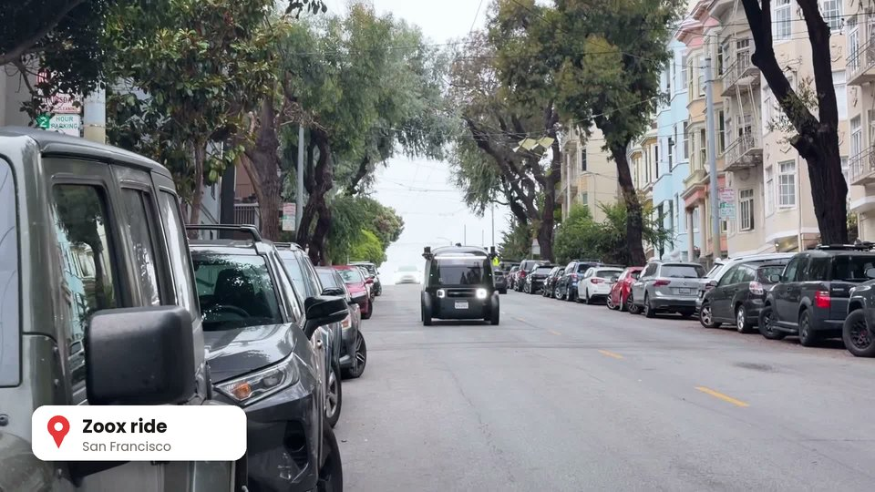 | Handheld on location: a stabilised walk-and-talk, b-roll cut to the music bed between thoughts, and a small place tag ("Nothing store · London") on arrival. | Store visits, campus tours, events, travel; the vlogs I already shoot. | The reel builds in `videos/nothing-store-london/` and `videos/halloween-reel/` for b-roll and beat-cutting, the warm & witty LUT and no captions. |

## What makes it premium

On Nov 9, 2026 I asked for every style to be lifted to the level of two creators whose videos feel premium to me: **RPN** (Roberto P. Nickson, short form) and **Riley** (Riley Brown, long form). This is what their videos have in common, with the numbers behind each rule. Every style's spec has a **Sound** and a **Premium polish** section that applies it.

**How the sound was measured.** Nobody listened. Each reference's audio was split into voice and everything else with Demucs, then measured with ffmpeg's loudness meter, onset detection and scene detection, and lined up with the transcript. Levels are good to a few dB. What a sound *is* (pop, click, whoosh; which track) is a guess from its length and spectrum.

| | RPN reel (62.8 s) | Riley video (12:31) |
| --- | --- | --- |
| Voice | −14.4 LUFS, loudness range 2.3 LU, high-passed near 100 Hz | File at −24 LUFS, loudness range 3.8–4.8 LU, high-passed near 100 Hz |
| Music | A constant low bed for the whole reel, **15 LU under the voice**, held within ±2 dB, fading over the last 0.8 s. Dark: most energy under 120 Hz, 16 dB down by 2–4 kHz | A soft pulsing bed in the **first 20.5 s only**, about **26 dB under the voice**, gone 2 s before the first demo. **Nothing under the other 12 minutes** |
| SFX | 23 short sounds (22 a minute): 19 ticks of 40–120 ms on named things appearing, 4 swells of 0.3–0.5 s on section changes | None found in the body: no sound on zooms, pushes or the click ring |
| SFX and cuts | **3 of 36 cuts** carry a sound | Cuts are silent |
| Cuts and beats | On words. No more beat-aligned than chance (28% vs 21%) | On words |
| Picture | 43 changes on top, one every 0.96 s, each the real page or app | 96% of the runtime is the real screen on one fixed page layout |
| Motion | Hard cuts; text moves take 0.3 s; the face never drifts | Push 10 frames, punch-in under 0.35 s, holds of 3–20 s |
| Colour | White, near-black, one green | White page, one tomato accent |
| End | A full-screen cheat sheet held 1.5 s: "take a screenshot" | The "5 reasons" board, filled in, is the recap |

### The checklist

1. **Show the real thing.** The page, app, post or document being named is on screen within a beat of the word. Drawn or generic visuals are for ideas that have no real screen.
2. **One layout, held.** Pick the frame (split, stage, demo page) and keep it. Variety comes from what is inside it.
3. **Voice first.** −14 LUFS on the voice alone. Loudness range ≤3 LU on shorts and ≤5 LU on long form. High-pass at 80–100 Hz. Level the voice before any music goes in.
4. **Music is felt, not heard.** Shorts: one bed, 15–20 LU under the voice (22 LU for sponsors), one level from frame 0 to a short fade, no ducking moves. Long form: a bed in the hook (and outro if wanted) at 20–26 LU under, out before the first demo, and nothing under demos.
5. **Pick a bed that stays out of the voice.** Low and steady, little going on at 2–4 kHz, no vocals, no lead melody.
6. **Cut on words, then fit the music.** Never move a cut to reach a beat. Once the cut is locked, slide the track so its drop or a bar line lands on the first graphic. That is what "beat-aligned" means in this repo.
7. **SFX mark things, not cuts.** A short quiet tick when a named thing appears, a soft swell or whoosh when a section changes, and silence on plain cuts, zooms and caption changes. Each style has a palette of 3–5 sounds and a cap per minute.
8. **Keep SFX under the voice.** Ticks, pops and clicks peak 6–10 dB under it (about −14 to −16 dBFS in a −14 LUFS mix). Whooshes and swells peak around −8 to −12 dBFS. One boom at most, on the hook.
9. **Motion is quick and then still.** Entrances settle within 10 frames (0.33 s). One thing moves at a time. The face framing changes only on a cut.
10. **Hold what must be read.** At least 1.5 s after the last element lands. Zooms hold 3 s or more.
11. **A small type scale.** Three sizes per style, one or two families, small captions of 1–3 words on shorts, none on long form.
12. **One accent colour**, used on one thing per shot. The real screens bring the rest of the colour.
13. **Grade the face, not the screens.** The LUT sits on the adjustment layer under the visuals; captures and recordings stay as shot.
14. **End on a frame worth a screenshot:** a cheat sheet, a filled-in list, the one number with its source. It should make sense as a still.
15. **Leave real moments in.** Waits for an app or agent to answer, and its own audio, are proof that it works.

### Sound defaults by format

| | Shorts and reels | Long form |
| --- | --- | --- |
| Voice | −14 LUFS, range ≤3 LU | −14 LUFS, range ≤5 LU |
| Bed level | 15–20 LU under the voice; 22 LU for sponsors | 20–26 LU under, hook and outro only |
| Bed timing | Frame 0 to the end, 0.4 s in, 0.8–1.5 s out | Out 1–2 s before the first demo; none under demos |
| SFX | Style palette, 4–10 a minute (RPN up to 20), none on plain cuts | Hook and section cards only; none inside demos |
| Final mix | −14 LUFS, −1 dBTP | −14 LUFS, −1.5 dBTP |
| Sponsored | Epidemic Sound tracks only | Epidemic Sound tracks only |

**Not measured:** what the references' music tracks and effects actually are, the RPN bed's tempo, either creator's voice chain (EQ, compressor and de-noise settings), and anything about how they sound on a phone speaker. Tempo ranges, instruments and the per-minute caps in each style are my editing judgement on top of the measurements. Two references is a small sample.

## Main style: warm & witty


This is my signature style and the default for every video. It's visual, not text-heavy. I'm the builder who actually tries things.

- **Animated UI cards first:** generic UI that acts out the line, such as a fare that counts up, an itinerary whose layover stretches, a calendar where the flight drags earlier, an incoming-call screen, a 2 AM lock screen, or a comment box typing the keyword.
- **Stickers over the footage** where UI can't show the idea, in the top band clear of my face, each landing on its payoff word:
  - small drawn visuals for asides (icons, mini illustrations), with no sticky notes or handwritten sentences
  - tomato number badges ("+$1,000 / change fees")
  - chat bubbles
  - pills
  - an "it works!" verdict stamp
  - a CTA pill
- **Captions:** 1–3 lowercase words in white Poppins ExtraBold with a dark outline. The key word sits in a tilted sky-blue `#7CC6FF` pill.
- **Palette:** sticky yellow `#FFE066`, tomato `#FF5D4A`, sky `#7CC6FF`, money green `#2EC46E`, white die-cut borders. No more than two accents per shot.
- **Full-screen paper board** whenever I'm reading off-camera. **Generic UI visuals** (e.g. a flight-search map) go full screen, then split screen with my face in the bottom half.
- **Pacing:** pauses over 0.3s are trimmed to about 0.15s, and every word is kept.
- **Sound:** an upbeat 100–120 BPM bed, 18–20 LU under my voice (22 LU for sponsors, who get Epidemic Sound only), slid so its drop lands on the first sticker. Five SFX (pop, bloop, whoosh, ding, cash), one per sticker moment, 8 a minute at most, none on plain cuts. −14 LUFS final mix.
- **Premium polish:** real captures before drawn UI, three type sizes, every entrance settled in 10 frames, boards held 1.5 s, and a screenshot-worthy recap before the CTA. See [What makes it premium](#what-makes-it-premium).
- **Grade:** a light corrective LUT that cools the warm indoor cast, on an FCP **adjustment layer** (Look Grade title plus Custom LUT) under the visuals.
- **Deliverables:** an FCPXML (cuts, stickers, captions, music and SFX on separate lanes), a `.cube` LUT, an `.srt` and a preview MP4.

Full spec for agents: [.claude/skills/warm-witty-style/SKILL.md](.claude/skills/warm-witty-style/SKILL.md). The reference build is a sponsored reel with its full toolkit: [videos/travelopod/](videos/travelopod/).

## Alternative style: editorial


My premium alternative to warm & witty, for when a video should feel like a magazine page instead of a sticker sheet. Use it only when I ask for it.

- **Type:** Instrument Serif headlines and captions. The key word is in Instrument Serif Italic with an oxblood rule drawn under it. Labels are Helvetica Neue Medium in tracked caps.
- **Palette:** paper `#F3EFE6`, ink `#181614` and one accent, oxblood `#B2221E`. Labels are stone `#786F64` and hairlines are `#C8C0B2`.
- **Cards:** plain paper pages with an ink rule on top and no labels, numbers or source lines. A serif statement is followed by an italic oxblood payoff on the beat. Real assets (including screenshots Harnoor shares) are framed documents, and drawings are re-inked in one ink.
- **Motion:** quint ease-out fades and rises (0.7 s in, 0.35 s out). No springs, wobble or tilt.
- **Sound:** a slow 70–90 BPM bed (felt piano, soft strings) 20 LU under my voice. Four quiet SFX (paper slide, tick, pencil stroke, one hook riser), 4 a minute at most.
- **Grade:** a soft film LUT (lifted blacks, −20% saturation, fine grain in the preview), on my face only.
- **Premium polish:** three type sizes per card, statement held 0.8 s before the payoff, finished cards held 1.5 s. See [What makes it premium](#what-makes-it-premium).

Full spec and kit: [.claude/skills/editorial-style/SKILL.md](.claude/skills/editorial-style/SKILL.md).

## Alternative style: dark cinematic


My moody premium alternative, for serious or high-stakes scripts. The shot stays the hero and the graphics look like lit glass. Use it only when I ask for it.

- **Type:** Helvetica Neue Medium for captions, with the key word in amber and no pill. Helvetica Bold for payoff lines. Labels are tracked caps at 55% white.
- **Palette:** white `#F5F5F2` with one accent, amber `#ECB65C`. Glass is `#0A0A0C` at 62% over the blurred shot, with a 2 px white edge at 18%.
- **Cards:** frosted dark glass panels that sample the footage behind them, with one soft light sweep per card. Real assets sit on the glass (dark logos inverted to white), and status changes get an amber glow outline.
- **Motion:** blur-in plus a 50 px rise (quint ease-out, 0.8 s), then a slow 18 px parallax drift. No springs, wobble or tilt.
- **Sound:** a dark 80–100 BPM half-time bed (sub bass, analog synth) 18–20 LU under my voice. Four SFX (hook riser into a sub boom, air whoosh, low tick, section swell), 4 a minute at most.
- **Grade:** a teal-shadow / warm-highlight film LUT with darker mids and −26% saturation, plus a vignette and grain in the preview. Captures on the glass stay ungraded.
- **Premium polish:** one light sweep and one moving card at a time, glass held 1.5 s, amber on one thing per shot. See [What makes it premium](#what-makes-it-premium).

Full spec, kit and LUT: [.claude/skills/dark-cinematic-style/SKILL.md](.claude/skills/dark-cinematic-style/SKILL.md).

## Alternative style: Proof Stack


An earlier favourite reference reel ([example videos/fav style.mp4](<example videos/fav style.mp4>)), made into a style. It turns every name in the script into real proof that stacks up on screen. Use it when I ask for Proof Stack.

- **Structure:** the face carries the hook, the opinion beats and the CTA. The middle is full-screen b-roll in a dark, defocused paper-floor space.
- **Objects:** real logo tiles, tilted paper pages, polaroid photos, lanyard badges that drop from the top, and browser windows. Each one lands sharp and centred on its word (0.35 s expo-out with motion blur). When the next one arrives, it recedes to a soft, dim satellite slot, so the proof accumulates.
- **Type:** small white Helvetica Neue Medium captions, sentence case, low in the frame. An occasional big Instrument Serif Italic accent word. A white "Comment X" pill CTA.
- **Grade:** a clean, near-neutral camera LUT on the adjustment layer.
- **Sound:** a light 100–115 BPM bed 19 LU under my voice, with its drop on the first cut to b-roll. Four SFX (whoosh into a scene, paper slide, tick per grouped drop, one hook boom), 10 a minute at most; cuts back to my face are silent.
- **Premium polish:** each object sharp for 0.8 s before it recedes, and the full stack in view for 1.5 s as the end frame. See [What makes it premium](#what-makes-it-premium).

Full spec and kit: [.claude/skills/proof-stack-style/SKILL.md](.claude/skills/proof-stack-style/SKILL.md).

## Alternative style: Split Stage (Nick Saraev style), my favourite


**My favourite style** (since October 25, 2026). The look from the Nick Saraev reference reel ([example videos/Nick Saraev style.mp4](<example videos/Nick Saraev style.mp4>)), made into a style. The proof sits above me instead of on top of me: a bright stage fills the top of the frame and my face stays visible underneath. Use it when I ask for "my fav style", the Nick Saraev style or Split Stage.

- **Structure:** on most shots the camera drops so my head sits low, under a light, frosted stage (pale blue-white with soft leaf shadows). The hook opens with a two-line title header. Stat beats cut to a dark, blurred full screen with a huge blue-gradient number. Opinion beats and the close are full-face.
- **Objects:** real pages as tidy browser windows with a blue outline and glow, light-blue marker highlights on the quoted line, magnified callouts ("13.8k stars", "400+ banks targeted"), logo cards and simple pill-and-line flow diagrams. Each one pops in (0.3 s expo-out, scale 0.9→1, blur to sharp) on its word.
- **Type:** big 1–3 word captions in black SF Pro Bold between the stage and the head, with the key word in blue Playfair Display italic. The title header is black SF Pro over white italic on a blue block. The CTA is a green glowing quoted word ("comment “Google”").
- **Grade:** a clean, bright, slightly cool camera LUT on the adjustment layer.
- **Sound:** a light, bright 105–120 BPM bed 19 LU under my voice. Five SFX (pop on a window, tick on a callout, whoosh into the dark stat scene, riser into the big number, one hook boom), 10 a minute at most.
- **Premium polish:** the stage changes with each named thing (every 2–3 s), windows hold 1.2 s before their highlight, blue is the only accent. See [What makes it premium](#what-makes-it-premium).

Full spec and kit: [.claude/skills/split-stage-style/SKILL.md](.claude/skills/split-stage-style/SKILL.md).

### Kallaway crop (pop-out head)


When I ask for the **Kallaway crop**, the camera goes in a rounded card at the bottom of the frame and my head **pops out above the card's top edge**, with the background removed. Raised hands break out too. It's from a Kallaway reel ("VIBE-CODE": a terminal window on top, the title above his head, his curly hair poking out over the card), October 2026. Since then it's my preferred framing for Split Stage split shots.

- **Card:** inset 24 px from the sides and bottom, top edge at y≈1330, about 96 px corner radius, a soft shadow and a thin rim. The camera keeps its real background inside the card. Everything outside the card is the stage.
- **Cut-out:** `./scripts/remove-background SOURCE.MOV -o matte.mov` (rembg / `u2net_human_seg` → ProRes 4444; `pip install -r scripts/requirements-cutout.txt` once). The matte's alpha moves with the camera, and `kallaway(stage, person)` in the Split Stage kit punches holes in the stage for the card and the person. In FCP the stage clip sits on the camera, so the head shows through.
- Graphics stay above y≈940 and captions sit just above the hair (y≈1012). Full-face and dark beats are unchanged.
- **Premium polish:** the card never moves or zooms during a split shot, the matte edge must be clean on every kept take (check hair and raised hands frame by frame), and the card takes no sound of its own. Sound follows the parent style (Split Stage or Dark Stage). See [What makes it premium](#what-makes-it-premium).

## Alternative style: Dark Stage


Split Stage's visuals on Proof Stack's dark floor ("best of both worlds"). Use it when I ask for Dark Stage, "the mix" or "like the Kimi reel".

- **Visuals from Split Stage:** the Kallaway card with the pop-out head, blue-outlined browser windows, marker highlights, magnifier callouts, logo cards, gradient stat numbers and the green glowing "comment" CTA.
- **Backdrop and captions from Proof Stack:** the dark, defocused paper floor made from the reel's own pages, small white sentence-case Helvetica captions and the occasional Instrument Serif Italic accent word.
- **"Lights out" variant:** the reel opens on Split Stage's white wall, then the lights go out on a key word and it stays dark (dark cinematic LUT and a soft vignette).
- **Sound:** a darker 90–105 BPM bed 19 LU under my voice, with the drop on the first dark run (or the lights-out word). Four SFX (hook boom, whoosh into a dark run, tick on a landing, page slide), 10 a minute at most.
- **Premium polish:** one object at a time, stat numbers held 1.5 s with their source window as the end frame. See [What makes it premium](#what-makes-it-premium).

Full spec and kit: [.claude/skills/dark-stage-style/SKILL.md](.claude/skills/dark-stage-style/SKILL.md).

## Alternative style: Minimal Proof


Quiet captions, real receipts. It comes from the Looki L1 sponsored cut and the Anthropic Residency / Canva reels (November 2026). Use it when I ask for Minimal Proof, "minimal captions" or the Looki / Anthropic residency style.

- **Captions:** lowercase Poppins Bold 62 px, white on a soft 55% black pill, 2–3 words a line, above my head (y≈200–300).
- **Proof:** recreated browser windows around real page crops (the exact line gets a yellow marker), real post screenshots with a source tag, and small chips. They pop in under my chin (y 1110–1580). Full-screen beats use a paper dot-grid board with a slow push-in.
- **Accuracy first:** every on-screen claim is checked against the source. When my line is looser than the page, the page's own wording goes on screen.
- **Sound and grade:** a light warm LUT on the adjustment layer, a calm 85–100 BPM Epidemic bed drop-aligned to the first card (~19 LU under my voice), and one CC0 Openverse SFX per card (whoosh, click, pop, cash), 6 a minute at most.
- **Premium polish:** everything moves inside 10 frames, windows hold 1.2 s before the marker, and the reel ends on the one source line that proves it. See [What makes it premium](#what-makes-it-premium).

Full spec and kit: [.claude/skills/minimal-proof-style/SKILL.md](.claude/skills/minimal-proof-style/SKILL.md).

## Alternative style: RPN


The real thing on top, me underneath. Learned from a reel by Roberto P. Nickson ([@rpn](https://www.instagram.com/rpn/), November 2026): techniques only, none of his footage or branding. Use it when I ask for RPN or "the RPN style". It suits tool lists and how-to reels where every item has a real page or demo to show.

- **Layout:** a hard 50/50 split at y 960 for about 70% of the reel. A real screen recording or page fills the top half and changes about once a second, on the word that names it. My face sits still in the lower half.
- **Captions:** 1–3 words in mono caps, white on a small near-black box that sits on the seam. No highlight colour and no animation.
- **Full-screen beats:** a wide-caps title card for each named item (its own screen blurred behind, sharp in a window), one full-face punch-in on the thesis line, a typed terminal for the how-to, and a black "screenshot this" cheat sheet before the sign-off.
- **Sign-off:** full face with big wide-caps words, one at a time. The CTA is the screenshot and the caption, not a comment word.
- **Cuts:** hard cuts only, on the words, pauses over 0.3 s trimmed.
- **Sound (measured Nov 9, 2026):** a fast levelled voice at −14 LUFS with a 2 LU range, over one dark low bed 15 LU under it for the whole reel. Short ticks land on named things (the reference has 19 in a minute) and soft swells on section changes; only 3 of 36 cuts carry a sound. My cap is 16 ticks and 4 swells a minute.
- **Premium polish:** three type sizes, nothing eases longer than 10 frames, green is the only accent, and the cheat sheet must work as a still. See [What makes it premium](#what-makes-it-premium).

Full spec and kit: [.claude/skills/rpn-style/SKILL.md](.claude/skills/rpn-style/SKILL.md). Sample stills: [styles/samples/rpn/](styles/samples/rpn/).

## Long form: Screen Share (default)


My real screen recording (or the pages rebuilt in Playwright when the recording is off) fills the frame, with my graded camera as a rounded corner cam at the bottom right. Full-face beats for opinions and stories.

- **Use it when:** the video walks through sites, data, articles or tools on screen. This is the default long form.
- **Built in:** `videos/h1b-lca/` (first build: rebuilt sites on a paper board, 288×360 corner cam), `videos/we-need-to-talk/` (frame above: synced screen recording, 300×375 corner cam, hand-drawn chapter boards) and `videos/fear-future-cs/` (ultrawide screen recording).
- **Recipe:** sync the screen by audio cross-correlation (`camera = screen + offset`), and bake the corner cam into opaque section clips on lane 2. Use punch-ins on the screen for the line being read, a light highlight box on the numbers and the grade on the lane-1 adjustment layer.
- **Sound:** voice at −14 LUFS with a range of 5 LU or less. A calm 85–100 BPM Epidemic bed (`~/Music/documentary es/`) in the hook and the last 15 s only, 22–26 LU under my voice, out 1–2 s before the first screen section. **No music and no SFX under screen sections** (measured on Riley). Up to three sounds in the hook (a soft whoosh into the first screen, a tick on a highlight box, a page flip on a chapter board), peaking at −16 dBFS. System and app audio from the recording stays in when it shows the thing working. Final mix −14 LUFS / −1.5 dBTP.
- **Premium polish:** one corner-cam size and position for the whole video (300×375, bottom right; move it only when it covers what I'm pointing at). Punch-ins take 8–10 frames, reach 1.6–2.2×, and hold 3 s or more; use a punch-in instead of a cut inside a section. One highlight colour. The screen stays ungraded. Come back to the same chapter board at each section so it fills in and ends as the recap. See [What makes it premium](#what-makes-it-premium).

## Long form: Light Stage


Split Stage's light frosted stage, made 16:9: real page crops in blue-outlined browser windows, gradient stat cards, chips and drawn diagrams land on the stage, with the corner cam baked in. Face beats stay plain, with small context notes bottom left.

- **Use it when:** a news or opinion take has no screen recording but needs receipts (pages, numbers, logos), or a podcast needs visuals between the two-shot.
- **Built in:** `videos/img1095/` (frame above, Microsoft buyouts) and `videos/shubham-podcast/` (TinyFish podcast, with 2× punch-ins from the 4K master); also the v2 scenes in `videos/we-need-to-talk/`.
- **Recipe:** `scenes.py` renders one 1920×1080 stage clip per scene on lane 2, with chips and lower thirds on lane 3. Every claim gets a real source, and loose lines keep a note on screen.
- **Sound:** voice at −14 LUFS with a range of 5 LU or less. A light, bright 100–115 BPM Epidemic bed in the hook and outro, 22 LU under my voice; it can return at 24–26 LU under stage scenes that have no app audio, and stays out of long face beats. Three SFX (soft pop on a window, tick on a callout or chip, soft whoosh into a stat card), **2 a minute at most**, peaking at −16 dBFS (whoosh −12 dBFS). Final mix −14 LUFS / −1.5 dBTP.
- **Premium polish:** the same blue outline, 0.3 s `Pop` and shadow as Split Stage; one object lands at a time; a stage scene holds 1.5 s after its last object; stat numbers 200 px or more, chips 36–40 px, context notes 28 px; blue is the only accent; the corner cam never changes size. End on a stage with the 3–5 receipts together. See [What makes it premium](#what-makes-it-premium).

## Long form: Paper Podcast


A two-person conversation from one locked wide shot, made dynamic with **punch-ins on cuts** (wide two-shot, then 1.7× close-ups on whoever's talking). It cuts to cream paper boards with small drawn science visuals, a blue tag title, a source line and the two-shot as a corner cam.

- **Use it when:** a podcast or interview with a researcher or expert, where the ideas need simple drawings rather than screenshots.
- **Built in:** `videos/michal-podcast/` (frame above, Google Research connectomics).
- **Recipe:** framing changes only at cut points. Wide holds ≥5 s, close-ups run 3–10 s, and a close-up needs ≥85% of the speech from that person. Use the FCPXML `adjust-transform` scale and position; `fill` conform is ignored, so use fit + explicit scale. Boards are drawn with the warm-witty `illus.py`, with ≤3-word labels.
- **Sound:** two voices matched to each other first (each at −14 LUFS, within 1 LU of the other, range 5 LU or less), room tone left under the gaps. A warm 70–90 BPM Epidemic bed (soft keys, no drums) for the cold open and the outro only, 24 LU under the voices. **No music under the conversation.** Two SFX (a paper slide when a board comes in, a pencil tick as a drawing lands), **1 a minute at most**, peaking at −18 dBFS. No sound on punch-ins. Final mix −14 LUFS / −1.5 dBTP.
- **Premium polish:** punch-ins are cuts, never animated zooms; boards dissolve in over 8–10 frames and hold 4 s or more; one blue tag title (40–44 px), labels 32–36 px, source line 24 px; one accent (the blue tag). End on the board that sums up the guest's main idea. See [What makes it premium](#what-makes-it-premium).

## Long form: Paper Explainer


Warm & witty's cream paper boards, made 16:9. Drawn explainers (timelines, maps, sensor diagrams, a levels ladder) build up step by step while I talk, with my graded camera as a 512×288 corner cam baked into the board clips. Full face for the intro, my take and the stories, and real ride b-roll between.

- **Use it when:** an explainer topic with no screen to record, where the idea is easier to draw than to screenshot (how a robotaxi sees, levels of self-driving, 70 years of history).
- **Built in:** `videos/zoox-reel/longform/` (frame above, "Is the robotaxi future finally real?").
- **Recipe:** warm & witty boards and `illus.py` drawings with labels of ≤3 words, a source line under each board and real page captures as cards. No captions; the grade goes on the lane-1 adjustment layer.
- **Sound:** voice at −14 LUFS with a range of 5 LU or less. A warm, curious 90–105 BPM Epidemic bed (plucks, soft keys) in the hook and outro at 22 LU under my voice, and under b-roll stretches where I'm not talking at 16–18 LU under where the voice would be. Out under long board explanations. Three SFX (pencil tick as a drawing step lands, paper slide for a new board, soft whoosh into b-roll), **3 a minute at most**, peaking at −16 dBFS. Real ride audio stays in under b-roll. Final mix −14 LUFS / −1.5 dBTP.
- **Premium polish:** one drawing step per spoken step, each landing in 8–10 frames; a finished board holds 1.5 s; board title 56–64 px, labels 36–40 px, source line 24 px; two accents per board at most and one for the video; real captures before drawings wherever a real page exists. End on the finished ladder, map or timeline as the recap. See [What makes it premium](#what-makes-it-premium).

## Long form: Night Desk-Typecraft


Learned in Nov 2026 from Typecraft's "I LOVE the herdr desktop app" video ([watch](https://www.youtube.com/watch?v=bBsNFZ1-HUs)), so the name credits him. It takes the techniques only, not his set, branding or clips. My face at the desk alternates with a full-frame **dark-mode** screen recording, which carries a **yellow-outlined portrait corner cam**. The picture changes about every 3.5 s (punch-ins, screen zooms, red boxes on what I point at), but the words aren't cut fast. One-word **keyword slams** land beside my head ("AGENTS"). **Chapter cards** sit on a dark scanline wall ("CODE to CALL"), and **neon diagram boards** with spaced mono titles build one box per step. It all runs under a moody night grade.

- **Use it when:** I ask for Night Desk, "the Typecraft style" or a darker, more energetic long form; tool reviews, "how I use X", setups, agent workflows.
- **Built in:** sample stills from `videos/we-need-to-talk/` footage (`styles/samples/night-desk/`). There's no full build yet.
- **Recipe:** spec, kit (`night_desk.py`: `punch`, `screen`, `corner_cam`, `red_box`, `slam`, `chapter`, `board`, `write_lut`) and LUT are in [.claude/skills/night-desk-style/SKILL.md](.claude/skills/night-desk-style/SKILL.md). Still no captions, and still loose cuts.
- **Sound:** a low synth or lo-fi bed at 80–95 BPM in the hook and outro only, 20–22 LU under my voice, and none under dense screen sections. Four SFX (whoosh-hit on a slam, thump on a chapter card, click on a board box, tick on a red box), 4 a minute at most, none on punch-ins.
- **Premium polish:** nothing but the 12-frame screen re-frame takes longer than 10 frames, finished boards hold 1.5 s, and the last board is the recap. See [What makes it premium](#what-makes-it-premium).

## Long form: Riley


Learned in Nov 2026 from Riley Brown's AI-tool videos ("Claude Duet's NEW Update Is INSANE", [watch](https://youtu.be/zU0jqYKTgMs)), so the name credits him. It takes the techniques only, not his set, mascots or branding. It's bright and friendly, the opposite of Night Desk. A **20-second hook on my face** at a warm, lit desk gets a **white app tile** and a **scramble label** ("POWERED BY OPUS 5.5"), one comparison graphic and a **proof beat** (the real announcement post next to the product's own clip). After that almost the whole video lives on one **white dot-grid page**: the screen sits in a big rounded card with my face in a plain portrait card on the right and a tomato bar along the bottom.

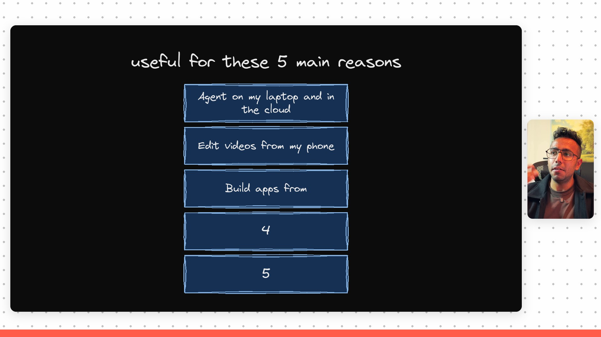 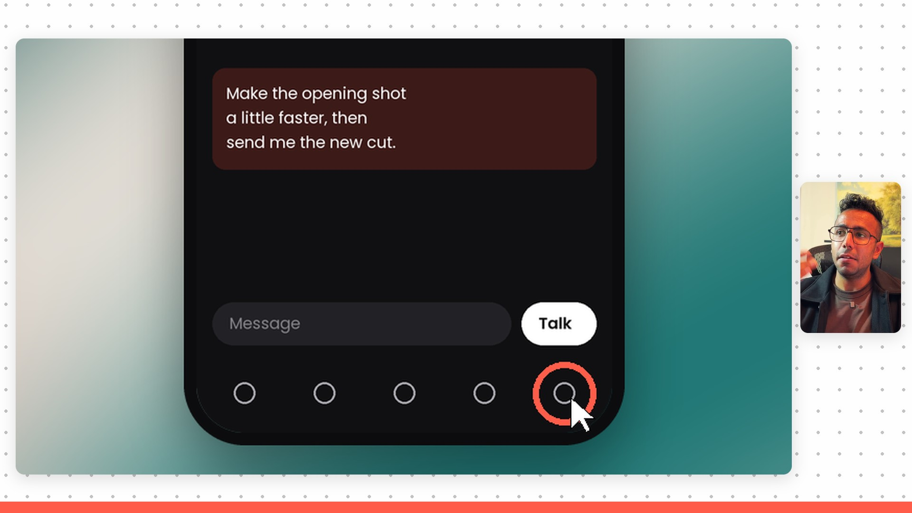

**Updated Nov 9, 2026 from the full reference video** (12:31, measured with scene detection and a transcript; the first version only had 64 still frames):
- **The split is 96% demo page, 2% full-screen face, 2% graphics.** The hook is 23 s in five shots, about one change every 4 s. There's one face return (5 s, a second closer angle, when he points at the room) and the outro stays on the demo page.
- **"N reasons" board instead of chapter cards.** A dark sketch board with five numbered boxes. At the start of each section I come back to it for 8–20 s and type that reason into its box, so the list fills in and ends up as the recap.
- **Phone demos:** the phone is mirrored to the Mac and sits in a phone frame on one blurred wallpaper, with the mouse cursor visible. That was 61% of the runtime.
- **Punch-in with a click ring:** the card's content zooms to about 2.2× in a third of a second, a tomato ring marks the tap, and it holds 3–20 s. There are no cuts inside a demo, only zooms.
- **Push between phone, desktop and board:** the new content slides in from the left in 10 frames. The content changes about every 40 s.
- **Sound (re-measured Nov 9, 2026 with a voice/music split):** a soft pulsing bed in the hook only, about 26 dB under the voice and gone 2 s before the first demo. Under the demos there is no music and no SFX at all, not even on the punch-ins or the click ring. The agent's spoken replies and the waits before them stay in. My version: bed 22–26 LU under in the hook, at most 4 soft sounds in the hook, none in the body. See [What makes it premium](#what-makes-it-premium).
- **Corrected:** the page arrives on a hard cut (not a rise), one wide layout covers every kind of screen, and the scramble label is bold and tight (not spaced caps). The giant word behind the head, pull-phrases, chapter cards and the list grid aren't in this video; they came from frames of his other videos and stay as optional extras.

- **Use it when:** I ask for Riley or "the Riley Brown style"; AI tool walkthroughs, "X just changed a lot", "how I use X", list videos ("5 reasons…").
- **Built in:** sample stills only (`styles/samples/riley/`). There's no full build yet. Stills 7 and 8 show the Nov 9 additions.
- **Recipe:** spec, kit (`riley.py`: `face`, `demo`, `phone`, `tiles`, `scramble`, `agenda`, `zoom`, `ring`, `push`, `proof`, `behind`, `phrase`, `chapter`, `grid`, `sketch`, `write_lut`) and LUT are in [.claude/skills/riley-style/SKILL.md](.claude/skills/riley-style/SKILL.md). Still no captions, and still loose cuts.

## Reel music folder

For future video edits, check `/Users/harnoor/Music/Reel Music/` for background music and choose a track that fits the script's mood. This is the user's preferred local music library.

**Which folder for what** (folder names as of Nov 9, 2026; always check the file is there before picking it):

| Folder under `~/Music/` | What it is | Use it for |
| --- | --- | --- |
| `Reel Music/` | My preferred library. Mostly well-known songs and instrumentals | Organic posts only. Never in sponsored posts |
| `documentary es/` | Epidemic Sound, calm documentary beds | Sponsored posts; Minimal Proof, editorial, Night Desk, Riley, Screen Share hooks |
| `new ES/`, `Other ES music/` | Epidemic Sound, more upbeat and electronic | Sponsored posts; warm & witty, Split Stage, Proof Stack, dark cinematic, Dark Stage |
| `Intro sound effects/` (`Risers/`, `Hits/`, `Wooshes/`, `Atmosphere/`) | Risers, hits, whooshes, room and city atmospheres | Hook risers and booms, whooshes into full-screen scenes |
| `30 WHOOSH SWOOSH/` | Thirty whooshes | Scene and board entrances |
| `SFX sting/` | Camera shutters | "Take a screenshot" and photo beats |
| `Other ES music/think sound effects/` | Assorted effects, including a cash register | Money lines, comedy beats in warm & witty |

**Choosing and placing a bed** (from [What makes it premium](#what-makes-it-premium)):
- Pick low and steady: no vocals, no lead melody, little going on at 2–4 kHz where the voice sits. Each style's **Sound** section gives a tempo range and instruments.
- Sponsored posts use Epidemic Sound tracks only.
- Set the level in LU under the voice, measured, not as a gain: 15–20 LU on shorts (22 LU for sponsors), 20–26 LU on long-form hooks. One level for the whole bed, with no ducking moves.
- Shorts: in on frame 0 and out with a 0.8–1.5 s fade. Long form: hook and outro only, out 1–2 s before the first demo, nothing under demos.
- Cut on the words first. Then slide the track so its drop or a bar line lands on the first graphic. Never move a cut to reach a beat.

See [the reel music catalog](reels%20music/README.md) for track candidates and mood labels. Check the actual files in the music folder before selecting a track; the catalog alone does not confirm an audio file is available.

## Sound effect vocabulary

Reference: [@kienobifilms' ten sound effects reel](https://www.instagram.com/reel/Dc_LiRWx0Yl/). Names transcribed from the on-screen labels on October 11, 2026. The uses below are our editing suggestions, rather than claims from the reel. These are vocabulary references; exact audio files have not been downloaded or identified.

| Sound effect | Suggested use in our edits |
| --- | --- |
| **Counting** | Number counters, countdowns, rising stats, or sequential list items; align ticks with each increment. |
| **Glitch** | A brief digital interruption, error, abrupt switch, or distorted text reveal. |
| **Cinematic Whoosh** | A large camera move, fast transition, or sweeping card entrance. |
| **Metallic Riser** | Build tension before a reveal, key claim, or beat drop; end the rise at the reveal. |
| **Low Hit** | A bass impact on a major title, reveal, or decisive cut. |
| **Camera Flash** | A flash transition, photo reveal, or snapshot moment. |
| **Camera Flash & Shutter Combined** | A photo capture beat combining a flash treatment with a shutter cue. |
| **Page Flip** | Turning a page, swapping documents, or revealing a new chapter or receipt. |
| **Shine** | A sparkle, polished detail, highlighted feature, or small success reveal. |
| **Pop** | A small label, icon, bullet, sticker, or card appearing. |

For future edits, use these names when discussing or searching for sounds. Match the sound's peak to the visual event and keep effects low enough for speech to stay clear. Choose effects for specific moments rather than placing one on every cut. Check existing local SFX assets before sourcing more.

**Placement rules** (measured on the RPN and Riley references, Nov 9, 2026; see [What makes it premium](#what-makes-it-premium)):

| Event | Sound | Length | Peak in a −14 LUFS mix |
| --- | --- | --- | --- |
| A named thing appears (icon, window, chip, label, list row) | Tick, Pop or click | 40–120 ms | −14 to −16 dBFS (6–10 dB under the voice) |
| A section changes, or a full-screen scene or title card starts | Soft swell or Cinematic Whoosh | 0.3–0.5 s | −8 to −12 dBFS |
| A number counts up | Counting | as long as the count | −16 dBFS |
| The hook's one big claim | Metallic Riser into a Low Hit, once per video | riser 0.5–1 s | −6 dBFS |
| "Take a screenshot", a photo | Camera Flash & Shutter | under 0.3 s | −12 dBFS |
| A plain cut, a punch-in, a zoom, a caption change | **Nothing** | | |
| Inside a long-form demo | **Nothing**, except the app's own audio | | |

- In the RPN reel only 3 of 36 cuts carried a sound, and 19 of its 23 sounds were short ticks on things he named. In Riley's 12 minutes of demos there were none.
- Each style lists its own palette of 3–5 sounds and a cap per minute (4 for editorial and dark cinematic, 6–10 for the proof styles, 8 for warm & witty, up to 20 for RPN, hook-only for long form).
- Glitch, Page Flip and Shine stay available but are style-specific: Glitch for the Glitch and Night Desk looks, Page Flip for paper styles, Shine at most once per video.

### Pro SFX tools for AI video editing

Tools that help an AI agent find, place or critique real sound effects for motion and talking-head edits. Check local SFX first; use these when sourcing or reviewing a pass. Short pointers only — follow each link for setup.

- **[Openverse API](https://api.openverse.org/v1/)** — search openly licensed media, including audio and sound effects (`/v1/audio/`, with filters such as `category=sound_effect`). Attribution and licence come with each result.
- **[Real SFX](https://github.com/Clipwing/skills/tree/edbefcbc3474869e6cc1e8a7ca583b0efd0dab7e/skills/real-sfx)** — a Claude Code skill (Clipwing) that places real recordings from your own library on the exact frame, keeps music and voice, and returns a new MP4 plus a separate SFX WAV.
- **[earshot](https://github.com/Leonxlnx/earshot)** — ears for coding agents: describe, match, find, critique and forge sound locally (CLI, Python API or MCP). CPU-only, open source.

## Favorites from @surosa.r

Source: [Instagram reel Dav1dTzsVTN](https://www.instagram.com/reels/Dav1dTzsVTN/).
Font names were transcribed from the reel's on-screen labels on October 11, 2026. Names reflect the labels shown in the editing app; exact font files and versions are not identified by the reel.

| Favorite font | Visual style in the reel | Pair with |
| --- | --- | --- |
| Poppins | Bold rounded sans serif | Playfair Display |
| Playfair Display | Contrasting italic serif | Poppins |
| Spire | Tall, narrow serif | Italianno |
| Italianno | Flowing calligraphic script | Spire |
| Modern | Heavy uppercase sans serif | Constane |
| Constane | Loose handwritten script | Modern |
| Buck | Heavy uppercase display font | Paface-It |
| Paface-It | Contrasting italic serif | Buck |

## Favorite combinations

1. **Poppins + Playfair Display** — bold main text with an italic serif accent.
2. **Spire + Italianno** — a narrow serif title with a flowing script accent.
3. **Modern + Constane** — a heavy uppercase title with overlapping handwriting.
4. **Buck + Paface-It** — a heavy display title with an italic serif accent.

The reel demonstrates white main text with yellow accent text. Some font labels show a diamond badge; check availability in your editor.

## Font sources

- [Poppins on Google Fonts](https://fonts.google.com/specimen/Poppins)
- [Playfair Display on Google Fonts](https://fonts.google.com/specimen/Playfair+Display)
- [Italianno on Google Fonts](https://fonts.google.com/specimen/Italianno)
- Search the exact labels **Spire**, **Modern**, **Constane**, **Buck**, and **Paface-It** in your editing app. External foundries and exact file identities for these labels have not been verified.

## Ready-to-use files

Download [ready-fonts.zip](ready-fonts.zip) and unzip it. The extracted `fonts/` folder contains official Google Fonts files and a copy of the SIL Open Font License for each family:

- **Poppins**: all 18 static styles, including Bold and ExtraBold for main titles.
- **Playfair Display**: regular and italic variable fonts (weight 400–900).
- **Italianno**: Regular script font.

For the first reel pairing, start with **Poppins ExtraBold** and **Playfair Display Italic**. Use **Italianno Regular** for the script accent in the second pairing.

To install on macOS, open the desired `.ttf` files in Font Book and choose Install. For an editor with custom font import, select files from this folder. Files are downloaded and ready to import; system-wide installation has not been performed.

## Free alternatives ready when needed

Exact free versions of the five remaining reel labels could not be verified. These are visually similar alternatives, not copies or confirmed aliases. All five families are downloaded from the official Google Fonts repository under the SIL Open Font License 1.1, with license files included. They can be used for personal and commercial video work under that license.

| Reel favorite | Free alternative ready to use | Suggested style |
| --- | --- | --- |
| Spire | [Instrument Serif](https://fonts.google.com/specimen/Instrument+Serif) | Regular; narrow serif, less condensed than Spire |
| Modern | [Archivo Black](https://fonts.google.com/specimen/Archivo+Black) | Regular; uppercase heavy title |
| Constane | [Allison](https://fonts.google.com/specimen/Allison) | Regular; thin flowing handwriting |
| Buck | [League Spartan](https://fonts.google.com/specimen/League+Spartan) | Black, weight 900; uppercase |
| Paface-It | [Bodoni Moda](https://fonts.google.com/specimen/Bodoni+Moda) | Italic, weight 400; contrasting serif accent |

Free pairings to use:

- **Poppins ExtraBold + Playfair Display Italic** — original names already ready.
- **Instrument Serif + Italianno** — alternative to Spire + Italianno.
- **Archivo Black + Allison** — alternative to Modern + Constane.
- **League Spartan Black + Bodoni Moda Italic** — alternative to Buck + Paface-It.

[Spire's foundry listing](https://p22.com/fonts/spire/) and [Constane's designer listing](https://creativemarket.com/SeagullsCreative/12762907-Constane-Handwritten-Font) offer paid licenses. These listings do not establish that their files are the exact editor versions shown in the reel. The other labels could not be tied confidently to a free standalone release.

The ZIP now includes **eight free font families / 28 font files**. See [free-alternatives.json](free-alternatives.json) for mappings, exact file paths, and research notes. Nothing is installed system-wide; the files are ready to import whenever needed.

Download sources, sizes and SHA-256 hashes are recorded in [font-downloads.json](font-downloads.json).

## Favorite skills

- **[Anatomy](https://skills.wheresryan.sh/anatomy)** by [@wheresryan22](https://github.com/wheresryan22/anatomy) (MIT) — name an idea in one line and Claude builds a live, interactive isometric figure of a working machine that demonstrates it. Outputs SVG/HTML, React components or custom elements, with optional WebGL shaders and 3D.

  ```bash
  npx skills add wheresryan22/anatomy
  ```

- **[OpenMontage](https://github.com/calesthio/OpenMontage)** by calesthio (AGPL-3.0, ~67K stars, [openmontage.video](https://openmontage.video)): an open-source, agentic video production system that turns an AI coding assistant like Claude Code into a production studio. It has 12 pipelines, 100+ tools and 700+ agent skill and knowledge files.
  - **Start from a reference video:** paste a YouTube video, Short, Reel, TikTok or local clip. It analyzes the transcript, pacing, scenes, keyframes and style, then proposes 2–3 concepts with a tool path, cost estimate and sample before full production.
  - **Pipelines worth trying for my edits:**
    - Clip Factory: ranked short-form clips from one long source
    - Hybrid: my footage plus generated support visuals
    - Animation: kinetic type and motion graphics
    - Animated Explainer, Documentary Montage, Cinematic
  - **Setup:** Python 3.10+, FFmpeg, Node 18+, then clone the repo and follow its Quick Start.
  - **License note:** AGPLv3, so use it as a tool rather than copying its code into anything I distribute.

### Motion and drawing skills

Confirmed agent skills for motion graphics and code-drawn stills. Frames below are from each project's own demo assets (or its sibling's, where noted). Keep warm & witty / Split Stage as the defaults for my reels; reach for these when a piece wants a full opener, explainer film or draw-on GIF.

- **[Bang Motion](https://github.com/bangtutorial/bang-motion)** by Bang Tutorial (MIT) — turns a coding agent into a motion designer: openers, promos, kinetic type and explainers as one continuous HTML world (not slides). Output is a single `index.html`, 16:9 or 9:16, with an optional frame-by-frame export to MP4.

  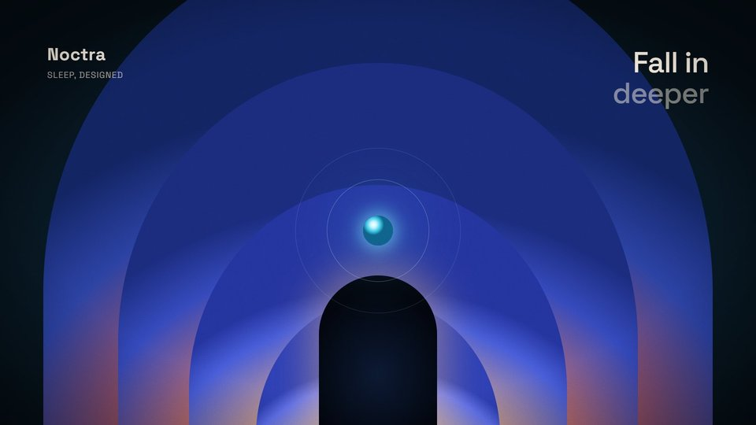

  ```text
  /plugin marketplace add bangtutorial/bang-motion
  /plugin install bang-motion@bang-motion
  ```

- **[Vox Explainer](https://github.com/CK42BB/vox-explainer-skill)** (MIT) — one topic in, a finished Vox-style explainer out: script, voiceover, Seedream keyframes, Omni Flash animation, MiniMax music, local ffmpeg assembly. Needs an [Atlas Cloud](https://atlascloud.ai) API key; roughly $3–8 per 60-second film. A full film was not smoke-run here (no key). **Honesty note:** collage clips shown in the reel actually come from the sibling skill [Vox Director](https://github.com/Alisa0808/vox-director) — list that too when pointing people at the look. Screenshot below is a Vox Director Tang Dynasty thumb for that reason.

  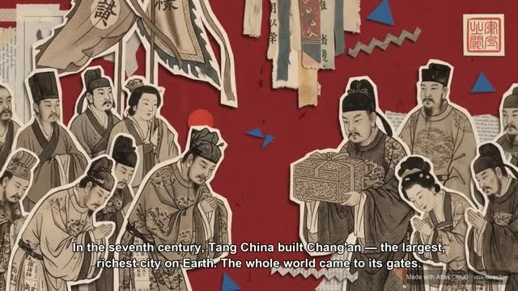

  ```bash
  git clone https://github.com/CK42BB/vox-explainer-skill.git ~/.claude/skills/vox-explainer
  # also useful: git clone https://github.com/Alisa0808/vox-director.git ~/.claude/skills/vox-director
  export ATLASCLOUD_API_KEY=…
  ```

- **[Huashu Art Motion](https://github.com/alchaincyf/huashu-art-motion)** by 花叔 / Huashu (MIT) — art styles written as code that actually move. **36 art styles per the repo** (reel said 30+), plus explainer grammars and a long-scroll skeleton. Skill docs are mostly Chinese; the English README only covers the overview. Needs uv, ffmpeg and Playwright Chromium.

  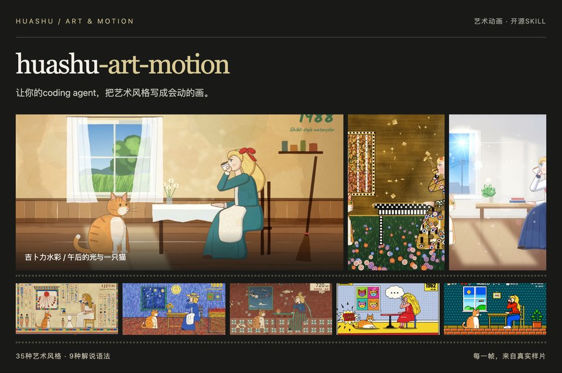

  ```bash
  npx skills add alchaincyf/huashu-art-motion
  ```

- **[Claude Drawing Skill](https://github.com/cloveric/claude-drawing-skill)** by cloveric (MIT) — Claude paints with code: **eighty styles per the repo** (an earlier note said 77). No image model — numpy + Pillow only — and it exports draw-on GIFs (plus stills). Clone into Claude skills and `pip install -r requirements.txt`.

  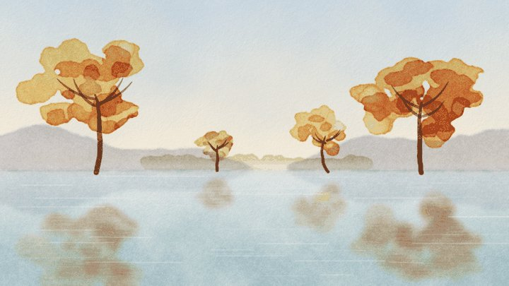

  ```bash
  git clone https://github.com/cloveric/claude-drawing-skill.git ~/.claude/skills/claude-drawing
  pip install -r ~/.claude/skills/claude-drawing/requirements.txt
  ```

### Opus 5.5 motion-design repos to clone

These come from [@0xMovez](https://x.com/0xMovez)'s X article ["How to build motion design studio with Opus 5.5 (Full-course)"](https://x.com/0xMovez/status/2104216919033192746) (September 27, 2026). All credit for the list goes to Movez. The descriptions are from each repo, as of October 2026.

| Use | Repo | What it is |
| --- | --- | --- |
| Music video | [JohnHeibel/PDoomVideo](https://github.com/JohnHeibel/PDoomVideo) | Source code for the Claude Opus 5.5 music video "I'm Upping My P(doom)". No license file, so it's for reference only |
| Starter | [JohnHeibel/ClaudeAnimationBase](https://github.com/JohnHeibel/ClaudeAnimationBase) | Starter kit for hand-painted cartoon animation with Claude: p5.js + p5.brush, the Clawd character, 31 acted emotions and a guide for the model (MIT) |
| Node canvas | [buildwithhanif/claude-animation-skill](https://github.com/buildwithhanif/claude-animation-skill) | Hand-drawn 2D animation as code: a detail bible, an ant rig, brush/watercolour pens, a frame-matched recreation loop and synthesized sound, using Node canvas + ffmpeg (MIT) |
| Framework (HTML) | [heygen-com/hyperframes](https://github.com/heygen-com/hyperframes) | "Write HTML. Render video. Built for agents." HyperFrames, the framework behind this repo's video skills (Apache-2.0) |
| Framework (React) | [Remotion AI skills](https://www.remotion.dev/docs/ai/skills) | Remotion's official Agent Skills for building React video compositions with Claude Code. Remotion needs a company license for teams over 3 |
| Long form | [WinterArc21/Battle-of-Austerlitz-Film](https://github.com/WinterArc21/Battle-of-Austerlitz-Film) | A long-form historical film built with code. No license file, so it's for reference only |
| Prompt library | [guanmo-ai/awesome-ai-motion](https://github.com/guanmo-ai/awesome-ai-motion) | Curated motion design, creative video and interactive art, with source code, prompts and making-of notes |
| Dataset | [athemeroy/awesome-opus-5-5-videos](https://github.com/athemeroy/awesome-opus-5-5-videos) (now `awesome-claude-5-5-videos`) | Source-linked Claude 5.5 video workflows: demos, prompts, tools and production evidence (CC-BY-4.0) |

## AI film stack (references)

This is a full pipeline for code-made films, one tool per stage. Follow each link for setup. These are references for when a piece needs more than our house styles. Keep warm & witty, editorial, dark cinematic, Proof Stack and Split Stage as the defaults for reels.

```
┣  STORY
┃  ┗  Superpowers brainstorming skill: pins down the story, hook and beats before anything gets built
┣  STYLE
┃  ┗  lemo-opuscar: 59 film styles made in code, pick one instead of the AI default look
┣  SETS
┃  ┗  MCP for Blender: Claude builds and lights every set, then looks at its own frames
┣  CHARACTERS
┃  ┣  ClaudeAnimationBase: a cartoon character kit with 31 acted emotions
┃  ┗  motion-design-skill: Disney's 12 principles rewritten for agents
┣  SOUND
┃  ┗  earshot: the agent hears its own mix and fixes the timing
┗  CUT
   ┗  HyperFrames: captions, voice and the final edit, written as HTML
```

| Stage | Repo | What it is | Get it |
| --- | --- | --- | --- |
| Story | [obra/superpowers](https://github.com/obra/superpowers) | An agentic skills framework. Its brainstorming skill locks the story, hook and beats before the build (MIT) | Claude Code plugin; see the repo |
| Style | [lemomo-ai/lemo-opuscar](https://github.com/lemomo-ai/lemo-opuscar) | 59 film styles made in code, each a style prompt plus a demo film made by Claude Opus 5.5, plus a guide for making your own style. [Gallery](https://lemomo-ai.github.io/lemo-opuscar/). Code is MIT; films and docs are CC BY 4.0 | `claude plugin marketplace add lemomo-ai/lemo-opuscar` then `claude plugin install lemo-opuscar@lemolab` |
| Sets | [ahujasid/mcp-for-blender](https://github.com/ahujasid/mcp-for-blender) | Community MCP plugin that lets an LLM build, light and render Blender scenes and check its own frames (MIT; not affiliated with the Blender Foundation) | Blender add-on plus MCP server; see the repo |
| Characters | [JohnHeibel/ClaudeAnimationBase](https://github.com/JohnHeibel/ClaudeAnimationBase) | Hand-painted cartoon starter: p5.js + p5.brush, the Clawd character, 31 acted emotions and `ANIMATION_GUIDE.md` (MIT) | Clone, `npm install`, then ask Claude to read `ANIMATION_GUIDE.md` |
| Characters / motion | [LottieFiles/motion-design-skill](https://github.com/LottieFiles/motion-design-skill) | Motion principles for agents: timing, easing, choreography and Disney's 12 principles adapted for UI (MIT) | `npx skills add LottieFiles/motion-design-skill` |
| Sound | [Leonxlnx/earshot](https://github.com/Leonxlnx/earshot) | Ears for coding agents: hear, critique and fix a mix, find and forge SFX. CPU-only, as a CLI, Python API or MCP server (MIT) | Python venv + `pip install -e ".[mcp]"`; see the repo |
| Cut | [heygen-com/hyperframes](https://github.com/heygen-com/hyperframes) | "Write HTML. Render video." Captions, voice and the final edit as HTML. It's already the framework behind this repo's video skills (Apache-2.0) | Already installed here as the `hyperframes` skills |

## Favorite motion styles

- **[Prompt Motion](https://prompt-motion.com/)**, curated by [@p4nthera_](https://x.com/p4nthera_): a gallery of motion videos made with Claude Opus 5.5. Each entry shows the prompt or skill behind it, and you can customize any prompt for your own project. Rights stay with each entry's linked creator.
  - Style categories: Product UI, Phone, Charts, Diagrams, Kinetic type, Shapes, Particles, Characters, Photos, Music, Code.
  - Filter by **Prompt** or **Skill** and sort by Popular. Kinetic type and Product UI are the biggest categories, so start there for video-edit text styles.
- **[Apple-keynote launch film](prompts/apple-keynote-launch-film.md)**: a free Opus 5.5 prompt shared on X. It builds a 1440×1440, 120 BPM, 54-beat one-take launch film in pure code, rendered with Playwright and ffmpeg. Scenes morph into each other with iOS 26 liquid glass, iris wipes, black floods and spring pops, and crossfades and blur-ins are banned. Fonts are Archivo (wdth 125, weight 800) and Geist.
- **[Opus 5.5 Motion Lab](https://x.com/flxrnc/status/2105311836190978392)** by [@flxrnc](https://x.com/flxrnc): an article that prints every prompt and follow-up behind three Opus 5.5 animations (liquid chrome title, earbuds product shot, voxel mascot). My [notes](prompts/opus-motion-lab-notes.md) cover its directed-prompt template, render contract, easing and spring numbers, and how to translate feedback into numbers.
  - Entries worth opening first (each page has the full prompt or skill):

    | Entry | Style | Format | Built with |
    | --- | --- | --- | --- |
    | [Claude motion designer showreel](https://prompt-motion.com/stephanlivera-df17a2) · @stephanlivera | showreel | 16:9 | Opus 5.5 |
    | [Shape morphing through UI states](https://prompt-motion.com/twoclipping-5cba86) · @twoclipping | shapes, product UI | 1:1 | HTML + Playwright |
    | [Bold kinetic type showreel](https://prompt-motion.com/shneural-2abdfa) · @shneural | kinetic type | 16:9 | Opus 5.5 |
    | [Abstract motion design reel](https://prompt-motion.com/ajith-io-b5626e) · @ajith_io | kinetic type, abstract | 16:9 | Opus 5.5 |
    | [Engraving-style Claude ad](https://prompt-motion.com/lexnlin-038035) · @LexnLin | kinetic type, photos | **9:16** | Opus 5.5 |
    | [Enxovaly baby app promo](https://prompt-motion.com/gabrielbuzziv-4ff0c6) · @gabrielbuzziv | app promo | 16:9 | HyperFrames |
    | [Dub promo video](https://prompt-motion.com/steventey-0d20e4) · @steventey | product UI, charts | 16:9 | Opus 5.5 |
    | [Recursion explained in genres](https://prompt-motion.com/emollick-8661a8) · @emollick | explainer | 16:9 | Opus 5.5 |
    | [Negroni recipe animation](https://prompt-motion.com/ror-fly-9950f1) · @Ror_Fly | step-by-step recipe | 1:1 | HTML |
    | [Cinetic skill launch film](https://prompt-motion.com/lexnlin-6161a6) · @LexnLin | launch film (skill) | 16:9 | Opus 5.5 |
    | [Reddit marketing tool launch video](https://prompt-motion.com/anthonyriera-9b1b2a) · @anthonyriera | launch video (skill) | 16:9 | Remotion |

- **[What Ships](https://whatships.com/)**: a curated feed of startup and product launch videos posted on X (2,400+ as of October 2026), each with view count, length and date. Rights stay with each company or creator.
  - Categories: AI, Developer Tools, Design, **Motion**, Productivity, Consumer, Hardware.
  - Use it for launch-video pacing and openers. Most launches run 0:10–1:30; the short ones (Claude Haiku 5.5 at 0:11, Grok Bot at 0:12, Fin 4 at 0:08) show how much a single idea can carry.
  - Motion-category picks: "How the whole Paper Mono launch video was made" by @agusegui, "how do you communicate that" by @jordanarchivess, "looksmaxxing for motion graphics" by @makwanatejas170, and Cinetic by @LexnLin (also on Prompt Motion). Search the site by handle.

- **[Thinking Orbs](https://github.com/Jakubantalik/thinking-orbs)** by Jakub Antalik (MIT, [live demo](https://orbs.jakubantalik.com)): monochrome dotted particle orbs, originally loading indicators for AI and agent UIs. They work well in video as an "AI is thinking" beat, a transition between cards, or a small accent next to a caption.
  - Nine states: `working` (particles on tilted orbits), `searching` (a scan line sweeps a dotted globe), `solving` (bands scramble, then click into place), `listening` (a waveform rolls through rings), `connecting` (a constellation wires itself), `weaving` (three strands braid around a sphere), `composing` (an undulating band), `breathing` (a slowly morphing ring), `shaping` (circle → triangle → square).
  - Two tuned sizes (`64` and `20`) and dark or light ink. Plain 2D canvas, no WebGL.

    ```bash
    npm install thinking-orbs
    ```

  - **For rendered video:** don't drop the React `<ThinkingOrb>` into a HyperFrames composition as-is. It runs on its own `performance.now` clock and pauses offscreen, so frames won't line up on render. Use its engine (`src/engine/`, pure math, deterministic in `t`) and paint each frame from the composition's timeline time instead. Pick a state that matches what's being said, e.g. `searching` for "reverse engineer", `connecting` for agents talking, `solving` for a reveal.

- **[Awesome Opus 5.5 Videos](https://github.com/yihui-dev/awesome-opus5-5-videos)** by yihui-dev (MIT list, ~4.2K stars): a GitHub collection of 513 viral videos made with Claude Opus 5.5, with the prompt each creator shared and a link to the original post. Prompts are in the repo's `prompts/` folder and `data/videos.json`.
  - Its README highlights 100 entries: Motion graphics (58), Explainers (16), 3D scenes (14) and Games & interactive (12). For video-edit graphics, start with Motion graphics and Explainers.
  - Each video and prompt belongs to its creator. The list's MIT license covers the list itself, not the prompts. You can watch each original side by side with a remake on [Skillry](https://skillry.dev/ai-videos/opus-5-5).

### 20 animation style options (learned October 2026)

Source: [@andremass.ai's Instagram reel DeIwVxbCvPr](https://www.instagram.com/reels/DeIwVxbCvPr/), posted October 6, 2026, which shows 20 styles built with Claude Code. Each style is shown as a short animated card in the reel. The style names come from the reel's on-screen list. The "What the reel shows" column is what I saw in its frames. The "Build it with" column is my own starting recipe, not something taken from the reel. The creator's full prompts are only available by commenting "STYLES" on the reel, so they aren't saved here.

| # | Style | What the reel shows | Build it with |
| --- | --- | --- | --- |
| 1 | **Swiss style** | Off-white card, huge "03" numeral, red circle, "MOTION GRID" label | Strict grid, flush-left heavy grotesk (Archivo Black / Inter 800), one red accent, off-white background; elements slide on the grid with ease-in-out-quart |
| 2 | **Kinetic type** | "RHYTHM" stacked and repeated in yellow and outline on black | One word repeated in solid and outline rows; rows scroll in opposite directions, letters stagger 1 frame apart, cut on the beat |
| 3 | **Pop art** | "POW!" burst on yellow halftone rays | Ben-Day halftone dots, black outlines, primary colors, speech burst that scale-pops (ease-out-back) with a shake |
| 4 | **Flat 2D** | Orange planet with an orbiting moon on navy | Flat shapes with no gradients, limited palette, simple orbits and loops in linear phase |
| 5 | **Clay 3D** | Soft orange star spinning on a pastel pink background | Rounded, puffy shapes, matte soft shading, pastel background, squash-and-stretch springs (damping 0.5) |
| 6 | **Glassmorphism** | "Midnight Glass" UI cards and weather widgets over a purple/blue glow | Frosted translucent cards (blur, 1px white rim) over a dark gradient; cards rise and stack on springs |
| 7 | **Y2K chrome** | Liquid chrome blob morphing on pale lavender | Iridescent chrome blobs, pale pastel background, metaball morph, glossy highlights |
| 8 | **Synthwave** | Striped sunset over a neon purple grid with mountains | Gradient sun, magenta/purple perspective grid scrolling toward the camera, mountain silhouette |
| 9 | **Risograph** | Purple squiggly star on cream | Two or three spot inks, grain texture, slight misregistration offset, cream paper |
| 10 | **Paper collage** | Torn paper pieces assembling "COLLAGE" in cut-out letters on kraft | Ransom-note cut-out letters, torn edges, tape, drop shadows; pieces slap in one per beat with a small rotation |
| 11 | **Glitch** | Color bars and "NO SIGNAL" | RGB channel split, scanlines, block displacement, TV color bars; quick 2–4 frame bursts, not constant |
| 12 | **Particles** | Purple particle sphere swirling on black | Thousands of dots forming a sphere or shape, swirling and re-forming (see [Thinking Orbs](https://github.com/Jakubantalik/thinking-orbs) for a monochrome take) |
| 13 | **Neobrutalism** | "MAKE IT LOUD." with a pink highlight, sticker and "CLICK ME →" button on yellow | Thick black borders, hard offset shadows, flat bright fills (yellow, pink), chunky sans; buttons press down 4px on click |
| 14 | **Bauhaus** | Red circle, blue square, yellow triangle, black semicircle on cream | Primary-color geometric shapes on cream; shapes slide and rotate into a balanced composition |
| 15 | **Memphis** | Pink, purple and teal shapes, squiggles and a grid on mint | '80s squiggles, dots, triangles and grids in candy colors; shapes bob on offset sines |
| 16 | **Vaporwave** | "AESTHETIC" title, retro Windows dialog, pink/cyan checkerboard floor | Spaced-out wide caps, retro OS windows, pink/cyan gradient and checker floor, slow drift |
| 17 | **Pixel art** | "LEVEL 1" 8-bit platformer scene with clouds and hills | Low-res pixel grid scaled up with nearest-neighbor, limited palette, stepped (non-eased) motion |
| 18 | **Isometric** | Isometric pastel city blocks rising | 30° isometric projection, pastel blocks that rise from the ground staggered by 2 frames |
| 19 | **Low poly** | Faceted low-poly Earth spinning on dark teal | Flat-shaded faceted 3D (three.js, flatShading), slow rotation, single key light |
| 20 | **Line art** | Low-poly Earth with an orbiting moon traced as lines | Single-weight strokes drawn on with SVG stroke-dashoffset, monochrome on a dark or light background |

**Premium pass for all 20** (Nov 9, 2026; the rules are in [What makes it premium](#what-makes-it-premium)). The look changes per style; the discipline doesn't:

- **Picture:** real captures of anything named still come first; the style dresses the frame around them. One accent colour from the style's palette, three type sizes, one thing moving at a time, entrances settled within 10 frames (stepped or looping styles such as Pixel art and Flat 2D keep their own motion but still hold finished frames 1.5 s). End on a frame worth a screenshot.
- **Voice and mix:** the same as every style: −14 LUFS voice, bed 15–20 LU under on shorts, SFX on things and section changes rather than cuts, final mix −14 LUFS / −1 dBTP. Sponsored posts use Epidemic Sound only.
- **Music and SFX by tone** (my judgement, not measured):

| Tone | Styles | Bed | SFX palette (cap per minute) |
| --- | --- | --- | --- |
| Clean and credible | Swiss, Bauhaus, Flat 2D, Line art | Minimal 90–110 BPM: soft keys, light pulse, no melody | Tick, soft click, soft whoosh (4) |
| Loud and fun | Pop art, Neobrutalism, Memphis, Kinetic type, Paper collage | Punchy 110–125 BPM: claps, bass, funk or breakbeat | Pop, slap or paper hit, whoosh, one hook hit (10) |
| Tech and AI | Glassmorphism, Particles, Glitch, Y2K chrome | Dark electronic 90–110 BPM: sub bass, soft arps, pads | Low tick, air whoosh, short glitch burst (Glitch only), shine once (6) |
| Nostalgic | Synthwave, Vaporwave, Pixel art, Risograph | Synthwave or lo-fi 80–105 BPM; chiptune for Pixel art | 8-bit blip or tape click, soft whoosh, one riser (6) |
| Dimensional | Clay 3D, Isometric, Low poly | Warm and bouncy 95–115 BPM: marimba, plucks | Soft pop, wooden tick as blocks land, soft whoosh (8) |

**Pick a style by the script's tone:**

- **Clean and credible:** Swiss, Bauhaus, Flat 2D or Line art. These suit explainers, data and how-to content.
- **Loud and fun:** Pop art, Neobrutalism, Memphis, Kinetic type or Paper collage. These suit hooks, hot takes and lists.
- **Tech and AI:** Glassmorphism, Particles, Glitch or Y2K chrome. These suit AI tools, product UI and launches.
- **Nostalgic:** Synthwave, Vaporwave, Pixel art or Risograph. These suit throwbacks, gaming and culture pieces.
- **Dimensional:** Clay 3D, Isometric or Low poly. These suit product shots, systems and "how it fits together".

### REA explainer style (learned October 2026)

Reverse-engineered from Eric Tech's [How To Use REA To Clone Any Software In Minutes](https://www.youtube.com/watch?v=FnB9tHKBJXQ) and used for the Short 5 graphics in [videos/rea-code-not-the-moat](videos/rea-code-not-the-moat).

- **Canvas:** warm off-white `#EBEAE7` with a faint dot grid. Every visual is a floating card: white or `#1C1C1E` terminal, about 24px radius, soft shadow.
- **One accent:** orange `#FF5A1F`, only for dashed selection boxes with a copy badge, target circles, chart spikes, arrows and small labels such as "clone" or "couple of days".
- **Type:** 1–3 word captions in heavy sans with one orange key word. Monospace for repo names and code.
- **Motion:** a new beat every 1.5–2.5s (vertical) or 2–4s (16:9). The camera glides or whips across one big board instead of crossfading. Signature moves: a star counter rolling to "60K+", a flat chart line that spikes vertically, an app gets a dashed duplicate (the "clone"), and CODE ↓ BINARY.
- **Sound:** a pop or click on every card entrance, typing ticks under prompts, whooshes on camera moves, and for big reveals a riser, then about 0.15s of dead silence, then an impact. Synthesized library: [videos/rea-code-not-the-moat/scripts/sfx.mjs](videos/rea-code-not-the-moat/scripts/sfx.mjs).
- **Over talking-head footage:** green-screen cards go in the top band (y 80–430) or chest band (y 1110–1580) of a 1080×1920 frame, clear of the face. No green artwork and no soft shadows on green, so the key stays clean.

## Popular editing styles

Creator names transcribed from an on-screen list, in the order shown. Handles are included where known. The full set of 15 style links is only available by commenting "STYLES" on the source post, so they aren't saved here. No style recipes are listed below unless this repo already has them.

| # | Creator | Handle / channel |
| --- | --- | --- |
| 1 | **Vox** | @vox |
| 2 | **Johnny Harris** | @johnny.harris |
| 3 | **MagnatesMedia** | @magnatesmedia |
| 4 | **Iman Gadzhi** | @imangadzhi |
| 5 | **Ali Abdaal** | @aliabdaal |
| 6 | **Imperial** | — |
| 7 | **Maximize** | @bymaximise |
| 8 | **Devin Jatho** | @devinjatho |
| 9 | **Arsacre** | — |
| 10 | **Natt Jongsala** | — |
| 11 | **Gawx** | YouTube [@GawxArt](https://www.youtube.com/@GawxArt) |
| 12 | **Sam Kolder** | @samkolder |
| 13 | **Kurzgesagt** | @kurzgesagt |
| 14 | **LEMMiNO** | — |
| 15 | **Metro Media** | @metromedia.house |

Spelling note for #9: one read said "Arscare"; **Arsacre** is used here for now. #11 is **Gawx** (YouTube Gawx Art), not GRAWX.

## Claude reel skills (Claude mobile app)

Slash-command reel templates from the Claude mobile app (Code tab). Attach a talking-head clip, run a command, and Claude generates a styled reel. No voiceover — music only, with one spoken line at the end. Setup lives in the creator's guide (comment "CUT" for a free editing template), not in the reel itself. Descriptions below are from the skill list and short previews; no build recipes are listed here.

Selected skills, in the order shown:

| # | Skill | What it shows |
| --- | --- | --- |
| 1 | `/glass-explainer-reel` | Explainer panel with graphics on glass cards. Preview flashed ~1–2s; visuals unverified. |
| 2 | `/cinematic-type-reel` | Orange card, big serif "more reps", smaller "than you've already" beneath. Spelling verified via the on-screen "Editing with …" pill. |
| 3 | `/depth-ui-reel` | Interfaces behind your head, cheat captions… Preview: floating UI behind the head, bottom caption "Number one". |
| 4 | `/image-cluster-reel` | Metaphor images cluster above your head. Preview: chess pieces, yin-yang stones, classical two-hands painting above him; caption "pair two opposites and let the gap do the work". |
| 5 | `/cutout-grid-reel` | 2×2 grid (fan of cash, dollar close-up, horse artwork, him), overlay "For example one dollar". Spelling verified via the result pill. |
| 6 | `/split-reel` | Face on top, animations below, full-screen windows. Preview mid-generation (dark dot-matrix card). |

Also in suggestion lists but not selected (the library has at least eight):

| # | Skill | What it shows |
| --- | --- | --- |
| 7 | `/explainer-panel-reel` | Close-ups plus a bottom panel with explainers |
| 8 | `/split-screen-document-plus-animations` | Document on the left, you on the right |

Machine-readable favorites are in [favorites.json](favorites.json).
